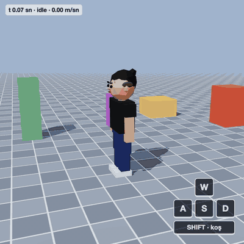
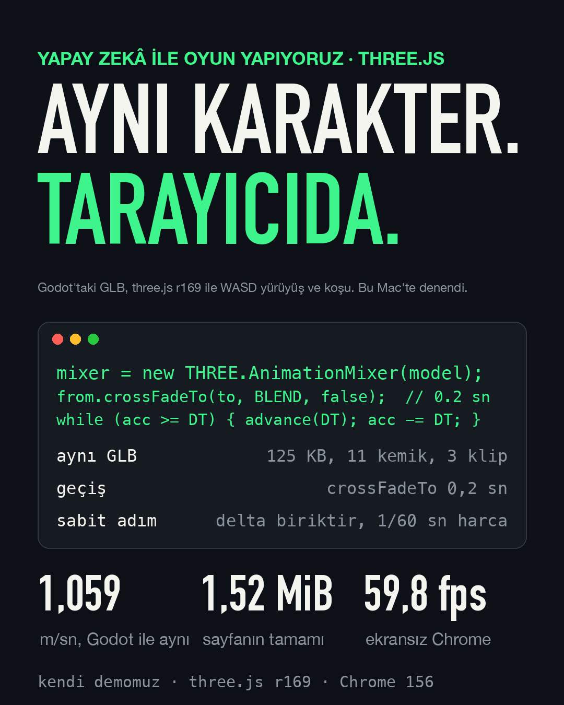

# three.js: aynı karakter tarayıcıda WASD ile yürüyor

Godot'ta yürüyen karakteri tarayıcıda bağlantı olarak paylaşmak istedik. Çözüm yeni motor değil: 57. bölümdeki Blender karakteri (aynı `tim_walker.glb`, 125 KB, 11 kemik, idle/walk/run) three.js r169 `GLTFLoader` + `AnimationMixer` ile açılıyor. Durum değişince `crossFadeTo` ile 0,2 sn geçiş; WASD yürür (1,08 m/sn), Shift koşar (2,40 m/sn), karakter gittiği yöne döner. Hareket hızı Blender'daki ayak hızına eşit, animasyon hızı (`timeScale`) gerçek hıza göre ölçekleniyor; ayak kaymıyor. Hareket 1/60 sn'lik sabit adımlarla harcanıyor, ekran hızı yürüyüşü değiştirmiyor.



[▶ Tam kalite oyun kaydı: demo.mp4](demo.mp4) (idle → W ile yürüyüş → D ile dönüş → Shift+W ile koşu)

[▶ Adım adım anlatımlı video (85 sn, dikey): video.mp4](video.mp4)



## Çekirdek kod

```js
mixer = new THREE.AnimationMixer(model);
from.crossFadeTo(to, BLEND, false);          // 0,2 sn geçiş
while (acc >= DT) { advance(DT); acc -= DT; } // delta biriktir, 1/60 sn harca
```

Tamamı [web/index.html](web/index.html) içinde; three.js kopyası `web/vendor/` altında, ek paket yok.

## Çalıştır

```bash
cd web && python3 -m http.server 8000
# http://localhost:8000            → klavyeyle oyna (WASD, Shift)
# http://localhost:8000/?auto=1    → tuşlara kodla basılır, ölçümler konsola yazılır
```

## Kaydı yeniden üret (headless Chrome, belirlenimci)

```bash
bash tools/run.sh realtime   # gerçek zamanlı koşu, fps ölçümü → logs/
bash tools/run.sh capture    # sanal saatle 240 kare → $TMPDIR/threejs-wasd/frames_raw
```

`tools/cdp_run.mjs` Chrome'u DevTools protokolüyle sürer (Node 24'ün kendi `fetch`/`WebSocket`'i; ek paket yok). macOS'ta Google Chrome yolu `run.sh` içinde.

## Ölçtüklerimiz (Chrome 156 headless, macOS)

| | Tarayıcı (three.js) | Godot |
|---|---|---|
| idle → walk geçişi | 1,02 sn | 1,03 sn |
| 180° dönüş | 0,33 sn | 0,33 sn |
| 90° dönüş | 0,17 sn | 0,17 sn |
| yürüme hızı | 1,059 m/sn | 1,059 m/sn |

- Sayfa toplam 1,52 MiB (1,305 MB'ı three.module.js); GLB açılıştan ~55 ms sonra hazır
- Ortalama 59,8 kare/sn (tarayıcı 60 Hz'e kilitli)
- Gerçek zamanlı koşu ile kare kare kayıt aynı 30 satırlık durum günlüğünü verdi

## Lisans

three.js kopyası kendi MIT lisansıyla `web/vendor/` içinde.
